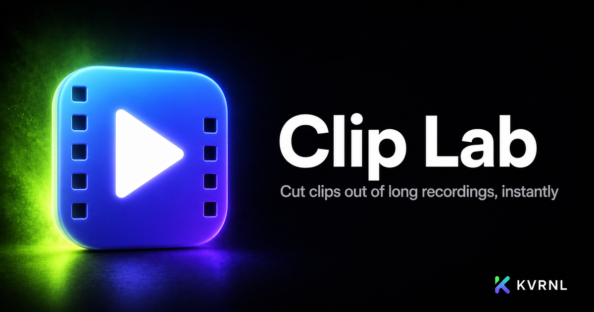

# Clip Lab

### Cut clips out of long recordings, instantly

 

Point Clip Lab at a long stream recording, mark the moments you want, and export clean clips in seconds. Instant lossless cuts or frame-perfect exports — nothing to set up.

### **[⬇&nbsp; Download Clip Lab — free at kvrnl.io](https://kvrnl.io/products/clip-lab/)**

 

---

## What it does

Clip Lab turns hours-long recordings into shareable clips fast. Open an OBS capture (or any MP4, MKV, MOV and more), scrub to the moment, mark a Start and End, name it, and add it to the queue — then batch-export the whole list at once. Even a six-hour file opens instantly because Clip Lab reads it in place.

Leave it on instant, lossless cuts, or flip on frame-perfect mode for exact edges — it re-encodes on your GPU (NVIDIA NVENC) and falls back to your CPU automatically. Everything runs locally, and you can even run several copies at once, one per video. Free to use; claim your license key and download it straight from this page.

## Features

- **Instant, lossless cuts — or frame-perfect re-encodes**
- **GPU (NVENC) export with automatic CPU fallback**
- **Queue up many clips and batch-export in one go**
- **Huge files open instantly — nothing to install**

## Download &amp; install

Clip Lab is **completely free**. Each install needs its own license key, which you get
with a free KVRNL account.

1. Go to **[kvrnl.io/products/clip-lab/](https://kvrnl.io/products/clip-lab/)**
2. Create a free account — email verification, nothing else
3. Claim your license key — instant, no waiting
4. Download and install

> [!NOTE]
> Clip Lab isn't code-signed yet, so Windows SmartScreen may warn you on first run.
> Click **More info → Run anyway**. Code signing is on the roadmap.

## Your license key

- **Free, one per product**, issued from your KVRNL account.
- **A key activates on one machine.** The first device to activate it claims it.
- **Switching computers?** Hit **Release device** on your
  [account page](https://kvrnl.io/account/) and the key is free to use again.
- Keys are checked over HTTPS at launch. See [Privacy](#privacy).

## Requirements

- **Windows 10 or 11** (64-bit)
- A free [KVRNL account](https://kvrnl.io/signup/) for your license key

## Privacy

Clip Lab sends KVRNL only what's needed to validate your license: **the key, the
product name, and a hardware ID**. No telemetry, no analytics, no tracking, and
none of your files. Full policy: **[kvrnl.io/privacy](https://kvrnl.io/privacy/)**

## What's new

**v1.0.10** — 2026-10-10
  - New: add text to your clips. Pick one of 12 ready-made styles, or make your own with any font, color, outline, drop shadow and highlight behind the text.
  - New: add stickers and emojis, and shapes like boxes, circles, stars, hearts and arrows. Drag them anywhere on the video and resize them from the corner.
  - New: animations. Text, stickers and shapes can fade, pop or slide in and out, and pulse while they are on. Choose when each one shows, and press play to preview it.
  - What you see on the video is what you get in the clip, including cropped and resized clips.

**v1.0.9** — 2026-10-10
  - New: crop your clips. Pick a shape like 9:16 for TikTok and Shorts, 1:1 or 4:5, or Free, then drag the box on the video to choose the part you want to keep.
  - New: choose a size for your clips: 1080p, 720p or 480p.
  - New: sound options for each clip. Keep the sound, remove it, save just the sound as an MP3, or split it into a silent video plus an MP3.
  - Each clip in the list shows its crop, size and sound, so one recording can give you a vertical clip and a widescreen clip in the same export. Cropped or resized clips take a little longer to save.

**v1.0.8** — 2026-10-08
  - Fixed: vertical videos, like phone recordings, now fit in the video area. You see the whole picture at any window size instead of having to stretch the window.
  - Widescreen videos also show in full now. Before, the bottom of the picture could be cut off, especially in a wide or maximized window.

**v1.0.7** — 2026-10-03
  - New: save any frame as a picture. Click the camera button under the video, or press S, and Clip Lab saves the exact frame you're looking at as a full-quality image, in the same folder as your clips.
  - Fixed: sending a report from Settings under Support could show an error even though the report arrived. It now says Sent when your report gets through, and if it really can't send you get a plain message and your report stays on screen.
  - Screenshots attached to reports are now sized so they always go through.

**v1.0.6** — 2026-09-26
  - Clip Lab can now share basic usage info with KVRNL to help improve it: your Windows version and hardware, which features you use, and errors. It asks you once, and you can switch it off anytime in Settings under General. It never sends your files, file names or videos.
  - When Clip Lab checks your license, it now also says which version you're running, so we can see when an update has reached everyone.

Full history → **[kvrnl.io/changelog/clip-lab](https://kvrnl.io/changelog/clip-lab/)**

## Documentation

Setup guides and how-tos → **[kvrnl.io/docs/clip-lab](https://kvrnl.io/docs/clip-lab/)**

## Support

> [!IMPORTANT]
> **We don't use GitHub Issues.** Report bugs from inside the app — it's the
> fastest route to us and it attaches the details we need automatically.

- 🐛 **Found a bug?** Use **Report a Problem** inside Clip Lab
- 💬 **Chat with us** → **[Discord](https://discord.gg/Ub4SdAuhu)**
- ✉️ **Anything else** → **[kvrnl.io/contact](https://kvrnl.io/contact/)**
- ❓ **FAQ** → [kvrnl.io/faq](https://kvrnl.io/faq/)

## License

**Proprietary freeware — free to use, not open source.**

This repository hosts the documentation and license for
Clip Lab. **The application source code is not published.** See
**[LICENSE](./LICENSE)** for the full terms.

---

 

**[kvrnl.io](https://kvrnl.io)** &nbsp;·&nbsp; **[All products](https://kvrnl.io/products/)** &nbsp;·&nbsp; **[Changelog](https://kvrnl.io/changelog/)** &nbsp;·&nbsp; **[Discord](https://discord.gg/Ub4SdAuhu)** &nbsp;·&nbsp; **[Contact](https://kvrnl.io/contact/)**

© 2026 <b>KVRNL</b> — an AI-powered software studio shipping free desktop tools.

